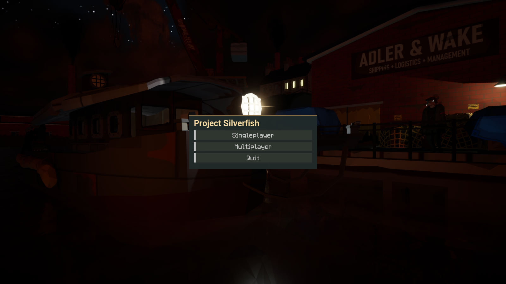
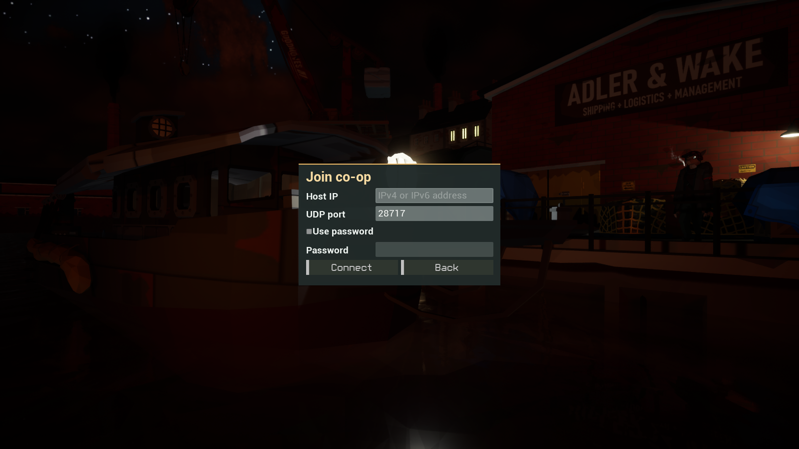
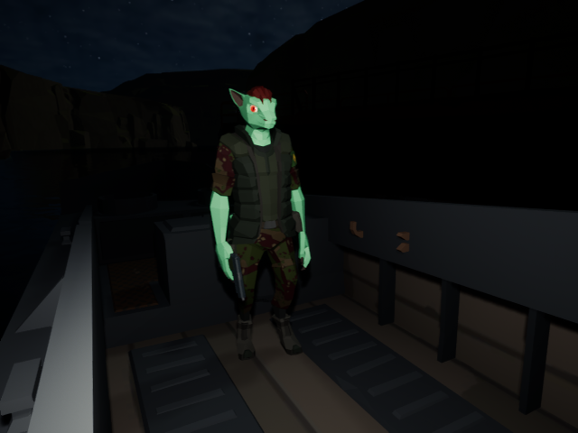

# Project Silverfish Co-op

> [!IMPORTANT]
> **Proof of concept in heavy development.** Use release candidates only if you plan to test and report bugs. For regular play, wait for a stable release. Expect incomplete features and changes between builds.
>
> If you find a bug, [open a GitHub issue](https://github.com/hypnotoadtrance/silverfish-coop/issues/new) with the release tag, map, reproduction steps, and what each player saw. Maintainers can assign reproducible reports to coding agents for investigation and draft pull requests.

**AI disclosure.** Much of this mod was made with AI, including OpenAI Codex. Human maintainers direct the work, playtest builds together, and use that feedback to guide development. As the mod maintainers understand it, Project Silverfish developer Siris Pendrake opposes generative AI. If you want to respect that position, we encourage you to skip this mod.

Anyone is free to use, modify, fork, and redistribute the original mod code for any purpose. Third-party components retain their own terms. [BSD Zero Clause License](LICENSE)

An unofficial UE4SS mod that adds co-op via Steam invites or Direct IP to the Windows Steam version of Project Silverfish. Open **Multiplayer** from the game’s title screen to host a campaign or join a friend. The mod runs in the existing Steam installation and keeps multiplayer campaigns separate from singleplayer saves.

[Download a release candidate](https://github.com/hypnotoadtrance/silverfish-coop/releases) · [Player guide](docs/PLAYING-COOP.md) · [18-rule design](docs/DESIGN.md) · [Contribute with a coding agent](CONTRIBUTING.md) · [Build and publish a release](docs/RELEASING.md)

## Install or update

1. Close Project Silverfish on both PCs.
2. Check the features and test coverage in the release notes. Download **Silverfish-Coop-RC-*.zip** from **Assets**. Both players need the same ZIP and a compatible Steam game build. [GitHub Releases](https://github.com/hypnotoadtrance/silverfish-coop/releases)
3. In Steam, right-click **Project Silverfish** and choose **Manage → Browse local files**. The game folder contains `SilverFish.exe`.
4. Extract the ZIP and merge its `SilverFish` folder into the game folder. Replace existing bundled files when prompted. This also updates the included UE4SS loader and its settings.
5. Launch from Steam and select **Multiplayer**. Use these same steps for future updates.

**Host.** Choose **Host**, then **New Game** to use the stock character creator or **Load Game** to resume a co-op campaign. In **Network**, choose Steam Networking or Direct IP. Direct IP uses a UDP port that defaults to **7777**. Either mode can use **Require password**.

**Join.** Choose **Join by Direct IP** and enter the host’s IP address, port, and password if enabled. Review the trust prompt on the first connection or after a host identity change. Choose a saved character for that campaign or create a new one. Character lists belong to each host campaign.

**Steam networking.** Launch through Steam on both PCs. When hosting via Steam, choose **Invite Only**, **Friends Only**, or **Public**. The host can select **Invite Steam Friends** from the pause menu in any of these modes. Friends can also use Steam’s **Join Game** in Friends Only and Public lobbies. Guests can browse Public lobbies in the **Multiplayer** menu. [Steam setup and playtest coverage](docs/PLAYING-COOP.md#steam-relay-trial)

For LAN play, use the host’s LAN address. For internet play, the guest needs a route to the host’s UDP port. This may require a host firewall exception and router port forwarding. Co-op saves default to `%LOCALAPPDATA%\SilverfishCoop\Resident`. The mod can back up host campaigns through Steam Cloud. Keep a local copy of important campaigns before changing builds. [Co-op backups](docs/PLAYING-COOP.md#steam-cloud-backups)

## Screenshots

| Join by Direct IP | A teammate as seen by the other player |
| --- | --- |
|  |  |

Captured in development builds. The Direct IP form shows a test port.

## What the mod covers

| Area | Current scope |
| --- | --- |
| Sessions | In-game Steam and Direct IP hosting, optional passwords, encrypted transport, and hot join. Direct IP recovery preserves the character after a short interruption. One host and up to four guests have connected in loopback tests. Most gameplay checks use two players. |
| Saves and characters | Co-op campaigns store the host’s world and each player’s character, inventory, and stash. New players can use the stock character creator and rejoin the same campaign with an existing character. Singleplayer has its own save scope. |
| Shared world | The host resolves supported loot pickups and drops, door state, party money, campaign flags, and travel. Covered zone exits enforce the host-only and party-distance rules. Verified traps and hazards use host-side damage and each player's health is reported separately. |
| Campaign gameplay | Supported paths cover downing, revives, party wipes, stock backpack and stash actions, merchant transactions, and selected NPC conversations and quest objectives. Observatory and Scientist counters, Sewer Thing barter, and qualified ordinary NPC barter use host-owned stock. Exact coverage varies by map and interaction. |
| Test and automation controls | Local commands expose session and gameplay status, events, and supported actions as JSON. They support human playtest operators and AI-assisted testing. |

[Verified native scenarios](docs/NATIVE-INTEGRATION.md) · [Current integration and known gaps](docs/IN-GAME-INTEGRATION.md) · [Machine-readable controls](docs/PLAYING-COOP.md#machine-readable-controls)

## Limitations and known issues

- **Campaign coverage.** Co-op is still in development. Some quests and dialogue triggers, faction updates, inventory actions, NPC behaviors, map exits, and scripted events lack complete multiplayer coverage.
- **Visual and physical state.** Muted tests have covered guest-carried physics props, red flares, boar ragdoll dragging, and selected enemies and anomalies. Coverage varies by actor, weapon, item, and map. Release notes list the checks for each ZIP.
- **Responsiveness.** Some interactions wait for the host to commit a change. Players have reported delays and Crossroads stutter. Muted loopback timings cover local iteration. Foreground and internet play can behave differently.
- **Networking.** A two-PC playtest confirmed Steam invite and join into a hosted campaign. The new lobby modes and browser have automated coverage. Steam reconnect, public discovery, and Steam’s Join Game still need a two-PC retest. Direct IP depends on the guest being able to reach the host.
- **Compatibility.** Each ZIP targets a qualified Windows Steam build and includes a pinned UE4SS version. A game update or another UE4SS mod can introduce conflicts. Very long installation paths can prevent a bundled Windows DLL from loading.

When [reporting a problem](https://github.com/hypnotoadtrance/silverfish-coop/issues/new), include the release tag, map, steps to reproduce, what each player expected and saw, and whether the connection was LAN or internet. Keep passwords, private invitation files, and save data out of issue reports.

## Development

Use the [development setup in the player guide](docs/PLAYING-COOP.md#stage-the-development-build), the [native build guide](native/README.md), and the [release workflow](docs/RELEASING.md). Run focused tests for incremental changes and save the full suite for major releases. Keep game files, extracted assets, saves, credentials, and build outputs out of Git. Compiled ZIPs are attached to tagged GitHub releases.
